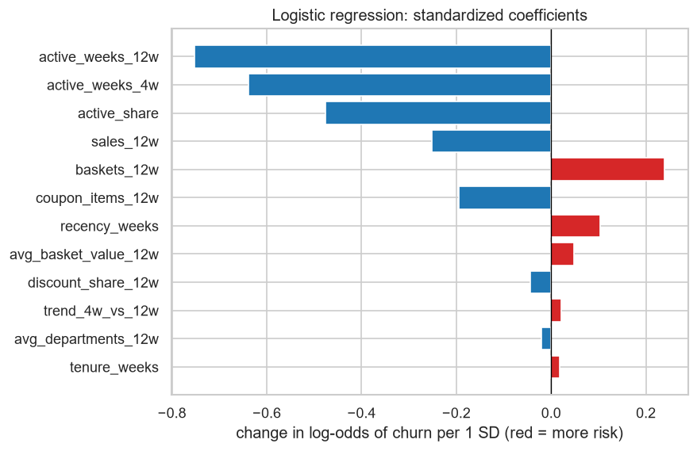

# Grocery Customer Retention: SQL, Churn Model and Coupon Targeting

**A grocery retailer can send a retention coupon to 10% of its active households. Who is about to stop shopping, and who is worth the coupon?**


## TL;DR

| | |
|---|---|
| **Problem** | Choose the 10% of at-risk households that get a retention coupon. |
| **Data** | dunnhumby *The Complete Journey* (Kaggle): 2.6M transaction lines, 2,500 households, 102 weeks. |
| **Approach** | 7 SQL queries (DuckDB) → 8-week churn labels at 9 snapshot weeks → recency rule vs logistic regression vs random forest, split by time → rank by churn risk × recent sales. |
| **Result** | The top 10% holds 82 churners vs ~19 at random (4.3x lift). Ranking by risk × sales reaches 35% of the sales at risk (41% on the validation week) vs 15% (17%) by risk alone. |
| **Recommendation** | Target by risk × sales, but A/B test first: ~788 households per group (~7 weekly lists). |

Tools: SQL (DuckDB), pandas, scikit-learn, SHAP, pytest (28 tests on GitHub Actions).

## 1. Data and churn definition

2,595,732 transaction lines, a product table (departments) and demographics for 801 of the 2,500 households (32%).
**Churn at week *c*:** the household bought in weeks *c−11 … c* ("at risk") and buys **nothing** in weeks *c+1 … c+8*.
Why 8 weeks: in 72% of the gaps between two purchase weeks the household comes back the very next week, and only 2% of the gaps last 8+ weeks. Churn here is a lapse, not a confirmed lost customer.

## 2. SQL and KPIs

All data preparation is SQL run by **DuckDB** on the raw CSVs; every query is tested on tiny hand-made tables.

| Query | SQL | Output |
|---|---|---|
| [`01_weekly_activity`](sql/01_weekly_activity.sql) | `GROUP BY`, `COUNT(DISTINCT)`, `LEFT JOIN` | household × week activity |
| [`02_rfm`](sql/02_rfm.sql) | CTEs, `CASE`, `NTILE(5)` | 5 segments from recency and frequency |
| [`03_period_retention`](sql/03_period_retention.sql) | self `LEFT JOIN` | 4-week retention |
| [`04_department_sales`](sql/04_department_sales.sql) | `JOIN`, `SUM() OVER ()` | sales share by department |
| [`05_purchase_gaps`](sql/05_purchase_gaps.sql) | `LAG() OVER (PARTITION BY …)` | silent weeks between purchases |
| [`06_household_demographics`](sql/06_household_demographics.sql) | `LEFT JOIN`, `CASE` | cleaned demographics |
| [`07_weekly_kpis`](sql/07_weekly_kpis.sql) | CTE, conditional `COUNT` | store KPIs per week |

A household is **active** in a week when its net sales are > 0, so a week with only returns does not count.

## 3. Key findings ([notebook 01](notebooks/01_eda_sql.ipynb))

1. **Stable business, rare churn:** ~1,300 active households and ~86k sales per week; ~90% of the households active in a 4-week period come back in the next one; ~7% of at-risk households churn in 8 weeks.
2. **Concentrated sales:** champions (bought in the last 2 weeks, among the 40% most regular) are 36% of households but 66% of sales.
3. **Churners are small spenders:** median 12-week sales of 65 vs 336 for the others.
4. **Possible survey bias:** households with demographics almost never churn (1% vs 11%), so the model does not use them.

## 4. Churn model ([notebook 02](notebooks/02_modeling.ipynb))


20,588 rows (household × snapshot week) with **12 behaviour features** that only use weeks ≤ cutoff (tested).
**Split by time:** train = weeks 30–78, validation = 86, test = 94 (used once). A random split would leak, because the same household appears in several snapshots.

| Model | Validation PR-AUC [95% CI] | Test PR-AUC [95% CI] | Test ROC-AUC | Lift @10% |
|---|:---:|:---:|:---:|:---:|
| Recency rule *(no ML)* | 0.256 [0.21, 0.32] | 0.265 [0.21, 0.32] | 0.816 | 3.9x |
| **Logistic regression** *(final)* | 0.296 [0.24, 0.37] | 0.326 [0.27, 0.39] | 0.857 | 4.3x |
| Random forest | 0.322 [0.26, 0.40] | 0.330 [0.27, 0.40] | 0.855 | 4.4x |

PR-AUC, not accuracy: with 8% churners, "nobody churns" is 92% accurate. Intervals: 1,000 bootstrap resamples.
**Why logistic regression:** tied with the forest (overlapping intervals), equally well calibrated (Brier 0.0628 vs 0.0625), which matters because the list multiplies the probability by sales, and its coefficients explain the risk.
Class weights and demographics did not help (class weights pushed the mean predicted churn from 7% to 29%).



Households that buy **often and regularly** are safe: 1 standard deviation more purchase weeks in the last 12 (~3.6 weeks) multiplies the odds of churn by 0.47.

## 5. Recommendation ([notebook 03](notebooks/03_explain_and_business.ipynb))

Budget 10%; *sales at risk* = what the churners spent in the last 12 weeks. Test week (validation week):

| Rank by | Churners reached | Share of sales at risk | List that does not churn |
|---|---:|---:|---:|
| churn risk | 82 (71) | 15% (17%) | 65% (69%) |
| **churn risk × sales** | 40 (31) | **35% (41%)** | 83% (87%) |
| recency rule × sales *(no model)* | 24 (21) | 25% (41%) | 90% (91%) |
| sales only *(no model)* | 2 (0) | 13% (0%) | 99% (100%) |

1. **Rank by expected sales lost** (risk × sales): fewer churners, but ~2.4x more of the sales at risk than by risk alone. It finds more churners than the simple rule × sales; its lead on sales holds on test but not on validation.
2. **Check the break-even, then A/B test.** A coupon pays off if it costs less than *r* × 31 per household (*r* = share of churners it keeps). To measure *r*, give it to a random half of the list: seeing churn drop 5 points (17% → 12%) needs ~788 households per group, ~7 weekly lists.
3. **Watch the churn rate** (6.8% in week 86 → 8.2% in week 94) and retrain regularly.

`python -m src.predict` writes the coupon list of the latest week (231 of 2,310 households) to [`reports/coupon_list.csv`](reports/coupon_list.csv).

## How to run

```bash
python -m venv .venv
.venv\Scripts\activate             # macOS/Linux: source .venv/bin/activate
pip install -r requirements.txt
pytest -q                          # 28 unit tests, no raw data needed
```

With the Kaggle CSVs in `data/raw/` (see [`data/README.md`](data/README.md)):

```bash
python -m src.data        # 7 SQL files          -> data/processed/
python -m src.features    # labels + features    -> data/processed/model_table.csv
python -m src.train       # validate, test, save -> models/churn_model.joblib
python -m src.predict     # latest week          -> reports/coupon_list.csv
jupyter nbconvert --to notebook --execute --inplace notebooks/*.ipynb
```

Code: `sql/` queries · `src/` pipeline (`features`, `train`, `business`, `predict`) · `notebooks/` 01 EDA, 02 models, 03 business · `tests/` 28 tests.

## What I learned and limitations

- **The churn definition and the time split mattered more than the algorithm:** two very different models ended 0.004 PR-AUC apart.
- **One week is noisy:** the same simple rule reached 41% of the sales at risk on the validation week and 25% on the test week, and the forest's lead over logistic regression went from 0.026 to 0.004 PR-AUC. I now check intervals and two weeks before believing a gap.
- **Probabilities need care when they meet money:** ranking needs only the order, risk × sales needs the values, so I checked calibration and skipped class weights.
- **Limitations:** churn = 8 weeks without a purchase (in a panel it can also mean leaving the panel); sales at risk is not sales saved, and the break-even uses sales, not profit; the coupon effect is unknown until an A/B test.

Data: dunnhumby – *The Complete Journey*, as distributed on Kaggle. Raw data is not included in this repo.
