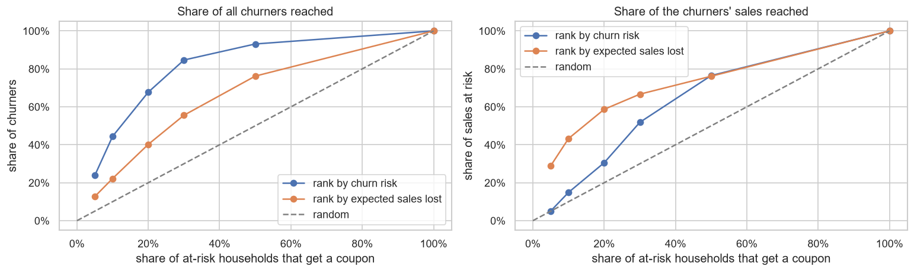
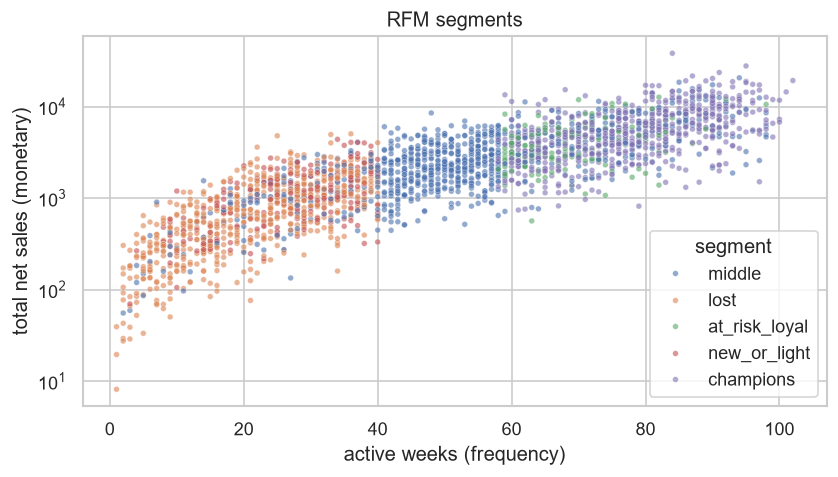
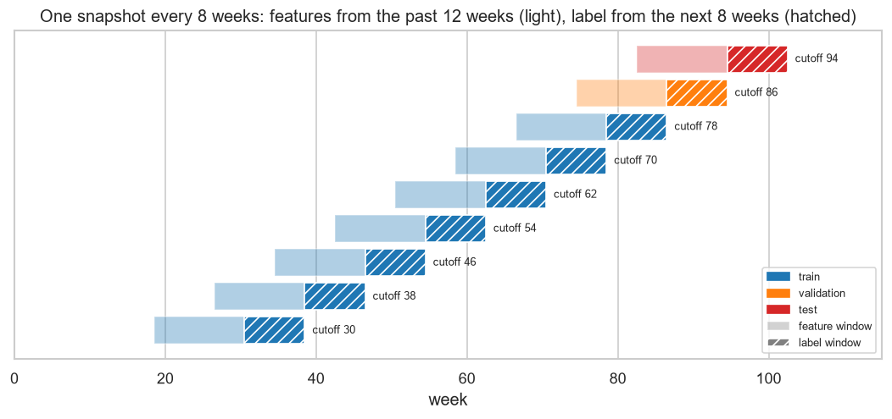
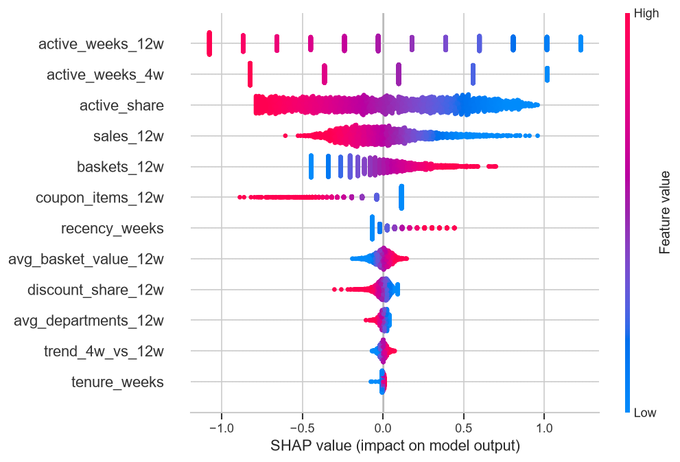

# Grocery Customer Retention: SQL Analysis, Churn Model and Coupon Targeting

**Which households are about to stop shopping, and which of them are worth a retention coupon?**

Data: dunnhumby *The Complete Journey* (2.6M transactions, 2,500 households, 102 weeks).
Tools: SQL (DuckDB), pandas, scikit-learn, SHAP, pytest.



## Summary

| | |
|---|---|
| **Business question** | A grocery retailer can send retention coupons to about 10% of its active households. Who should get them? |
| **Analysis (SQL)** | 7 DuckDB queries (KPIs, RFM segments, retention, purchase gaps), each unit-tested. Champions are 24% of households but 47% of sales. |
| **Model** | 8-week churn model with a time-based split. The top 10% riskiest households contain 84 churners vs ~19 at random (4.5x lift). |
| **Recommendation** | Rank households by **churn risk × recent sales**: with the same budget it reaches **43%** of the sales at risk, vs 15% when ranking by risk only and 25% with a simple rule without the model. Test the real coupon effect with an A/B test first. |
| **Deliverables** | 4 notebooks, coupon list script, 23 unit tests |

## 1. Problem and data

The budget covers about **10%** of active households, so the retailer needs to know **who** is likely to stop shopping in the next 8 weeks, and **who is worth** a coupon.

| Table | Rows | Used for |
|---|---:|---|
| `transaction_data` | 2,595,732 | one row per product line in a basket: sales, discounts, coupons, week |
| `product` | 92,353 | department of each product |
| `hh_demographic` | 801 | age, income, household size, home ownership (only 32% of households) |

**Churn at week *c*:** the household bought something in weeks *c-11 … c* (it is "at risk") and buys **nothing** in weeks *c+1 … c+8*.
Why 8 weeks: in 72% of cases a household buys again the very next week, and only 2% of the gaps between two purchases last 8 weeks or more (notebook 01).

## 2. SQL and KPIs

All data preparation runs in SQL with **DuckDB**, directly on the raw CSVs. Every query is tested on tiny hand-made tables ([`tests/test_sql.py`](tests/test_sql.py)).

| Query | SQL technique | Output |
|---|---|---|
| [`01_weekly_activity`](sql/01_weekly_activity.sql) | `GROUP BY`, `COUNT(DISTINCT)`, `LEFT JOIN`, `CASE` | household × week activity (123,976 rows) |
| [`02_rfm`](sql/02_rfm.sql) | CTEs, window function `NTILE(5)` | RFM scores and 5 customer segments |
| [`03_period_retention`](sql/03_period_retention.sql) | self `LEFT JOIN` | retention from one 4-week period to the next |
| [`04_department_sales`](sql/04_department_sales.sql) | `JOIN`, window `SUM() OVER ()` | sales share by department |
| [`05_purchase_gaps`](sql/05_purchase_gaps.sql) | `LAG() OVER (PARTITION BY ...)` | silent weeks between two purchases |
| [`06_household_demographics`](sql/06_household_demographics.sql) | `LEFT JOIN`, `CASE` cleaning | text ranges → numbers (`"50-74K"` → 62), unknown → `NULL` |
| [`07_weekly_kpis`](sql/07_weekly_kpis.sql) | CTE, conditional `COUNT` | store KPIs per week |

**KPI definitions** (the same in SQL and Python):

| KPI | Definition |
|---|---|
| Active household (in a week) | net sales in that week > 0, so a week with only returns does not count |
| Basket value | net sales / number of baskets |
| Discount share | discounts / (net sales + discounts) |
| 4-week retention | share of the households active in period *p* that are active again in period *p+1* |
| 8-week churn rate | share of at-risk households with no purchase in the next 8 weeks |

**Data quality:** no missing values or duplicated rows in the transactions; 0.7% of lines are returns or free items (kept in net sales);
discounts are stored as negative numbers (the SQL flips the sign); demographics are missing for 68% of households (the model does not use them, see below).

## 3. Key findings



1. **The business is stable and churn is rare.** After a warm-up of ~17 weeks: ~1,300 active households and ~86k net sales per week, and ~90% of the households active in a 4-week period come back in the next one.
2. **Sales are concentrated.** Champions are 24% of households but 47% of sales; "lost" households are 26% of households and only 7% of sales.
3. **Churners are small spenders.** Median sales in the last 12 weeks: 65 for churners vs 336 for the others. Targeting by risk alone spends coupons on small losses.
4. **Possible survey bias.** Households with demographics almost never churn (1% vs 11%). One possible reason (not verified): only loyal households answered the survey.

## 4. Churn model



- **9 snapshots** (cutoff weeks 30, 38, …, 94) → **20,588** rows (household × cutoff week), churn rate **~7%**.
- **Features** ([`src/features.py`](src/features.py)): 12 behaviour features (recency, how regularly the household buys, recent sales and baskets, discounts, coupons, departments). Demographics are not used by the model: they add nothing and look biased (see below). The features only use weeks ≤ cutoff (tested in [`tests/test_features.py`](tests/test_features.py)).
- **Preprocessing** (`log1p` for the skewed amounts, then standardizing) sits inside a scikit-learn `Pipeline`, so it is fitted on training data only.
- **Split by time, not at random**, because the same household appears in several snapshots and in real use we predict the future from the past:
  - **train** on weeks 30 … 78, **validation** on week 86 (choose each model's settings), **test** on week 94, used once at the end;
  - the final model is then **refit on all snapshots** and saved, so the coupon list uses the most recent data.

**Results** (test week: 2,316 households, churn rate 8.2%), with 95% bootstrap intervals:

| Model | Validation PR-AUC [95% CI] | Test ROC-AUC | Test PR-AUC [95% CI] | Precision @10% | Lift @10% |
|---|:---:|:---:|:---:|:---:|:---:|
| Recency rule *(baseline, no ML)* | 0.256 [0.21, 0.32] | 0.816 | 0.265 [0.21, 0.32] | 0.320 | 3.9x |
| **Logistic regression** *(final model)* | 0.296 [0.24, 0.37] | 0.857 | 0.326 [0.27, 0.39] | 0.355 | 4.3x |
| Random forest | 0.322 [0.26, 0.40] | 0.855 | 0.330 [0.27, 0.40] | 0.359 | 4.4x |

LightGBM was tried too and tied with both models, so it was dropped: two models are enough to compare a linear model with a tree model.

> **Why not accuracy?** With 8% churners, predicting "no churn" for everyone already scores 92% accuracy. PR-AUC and precision in the top 10% (the coupon budget) show what matters.

Both models beat the recency rule, and they are tied with each other (their intervals overlap on validation and on test).
So I keep **logistic regression**: its probabilities are as well calibrated as the forest's (this matters because the coupon list multiplies them by sales), and its coefficients explain the risk directly.
Contacting the top **10%** reaches **44%** of all churners; the top 20% reaches 68%.

**Explainability and experiments** ([notebook 03](notebooks/03_explain_and_business.ipynb), [notebook 04](notebooks/04_experiments.ipynb)):



- **SHAP:** risk goes up with long silences (`recency_weeks`) and down for households that buy often, regularly and from many departments. "Demographics missing" is also used by the model, but validating without demographics gives the same PR-AUC (0.348 → 0.349), so the model does not depend on that possible bias.

| Question | What I tried | Result | Decision |
|---|---|---|---|
| Which model? | logistic, random forest, small grid each | tied, both beat the baseline | logistic regression: as good, easier to explain |
| Class imbalance? | `class_weight="balanced"` | no ranking gain; mean predicted churn goes from 7% to 29% | train on the real data, use PR-AUC / top-k |
| Which threshold? | 0.5, best F1, top 10% | 0.5 flags nobody | top-k for a fixed budget |
| Need demographics? | validate with / without | 0.348 vs 0.349 | behaviour carries the signal |

## 5. Recommendation: who gets a coupon?

On the test week, with a budget of 10% (231 households). *Sales at risk* = what the churners spent in the last 12 weeks.

| Rank households by | Churners reached | Share of all churners | Share of the sales at risk |
|---|---:|---:|---:|
| churn risk (model) | 84 | **44%** | 15% |
| **churn risk × sales in the last 12 weeks (model)** | 42 | 22% | **43%** |
| recency rule × sales *(no model)* | 24 | 13% | 25% |
| sales only *(no model)* | 2 | 1% | 13% |

1. **Send coupons by expected sales lost** (churn risk × recent sales). It finds fewer churners, but the ones who matter most for revenue. Without the model (last two rows) the same budget reaches much less of the sales at risk.
2. **Run an A/B test before rollout:** give the coupon to a random half of the list and compare churn after 8 weeks. This data cannot tell how many churners a coupon really keeps.
3. **Watch the churn rate:** it rose from 6.8% (week 86) to 8.2% (week 94). Track it every week and retrain the model regularly.
4. **Check how demographics are collected** before using them in any decision.

`python -m src.predict` scores the 2,310 households at risk in the latest week and writes the top 10% to [`reports/coupon_list.csv`](reports/coupon_list.csv).

## How to run

```bash
python -m venv .venv
.venv\Scripts\activate             # macOS/Linux: source .venv/bin/activate
pip install -r requirements.txt
pytest -q                          # 23 unit tests, no raw data needed
```

To rebuild everything, download the dataset from Kaggle (see [`data/README.md`](data/README.md)), put the CSVs in `data/raw/`, then:

```bash
python -m src.data             # run the 7 SQL files             -> data/processed/
python -m src.features         # churn labels + features         -> data/processed/model_table.csv
python -m src.train            # validate, test, save the model  -> models/churn_model.joblib
python -m src.predict          # score the latest week           -> reports/coupon_list.csv
```

Notebooks, in order: [`01`](notebooks/01_eda_sql.ipynb) SQL & EDA → [`02`](notebooks/02_modeling.ipynb) features & models → [`03`](notebooks/03_explain_and_business.ipynb) SHAP & targeting → [`04`](notebooks/04_experiments.ipynb) experiments.

```
dunnhumby-retention/
├── sql/                   7 SQL files, run with DuckDB on the raw CSVs
├── src/
│   ├── config.py          all settings: churn windows, validation/test weeks, coupon budget
│   ├── data.py            load CSVs, data-quality report, run the SQL files
│   ├── features.py        churn labels + features at a cutoff week
│   ├── train.py           preprocessing, validation, test, saves the final model
│   ├── experiments.py     class weights, bootstrap, threshold helpers (notebook 04)
│   ├── business.py        RFM segment shares, churners and sales at risk reached by a ranking
│   └── predict.py         scores the latest week -> coupon list
├── notebooks/             01 SQL & EDA · 02 modelling · 03 SHAP & business · 04 experiments
├── tests/                 23 unit tests (SQL, labels, no future data, pipeline, metrics)
└── reports/               figures, results, coupon list
```

## Lessons and limitations

- **The churn definition and leakage-free features mattered more than the algorithm**: three different models land within 0.01 PR-AUC.
- **Who to target matters as much as how good the model is**: thinking in sales lost changed the coupon list.
- "Churn" = 8 weeks without a purchase, not a confirmed lost customer; in a panel dataset it can also mean a household left the panel.
- "Sales at risk" is not "sales saved": the coupon effect is unknown until an A/B test.
- Next steps: an **A/B test** for the coupon effect, and later **uplift modelling** (who actually responds to a coupon).

Data: dunnhumby – *The Complete Journey*, as distributed on Kaggle (see [`data/README.md`](data/README.md)). Raw data is not included in this repo.
